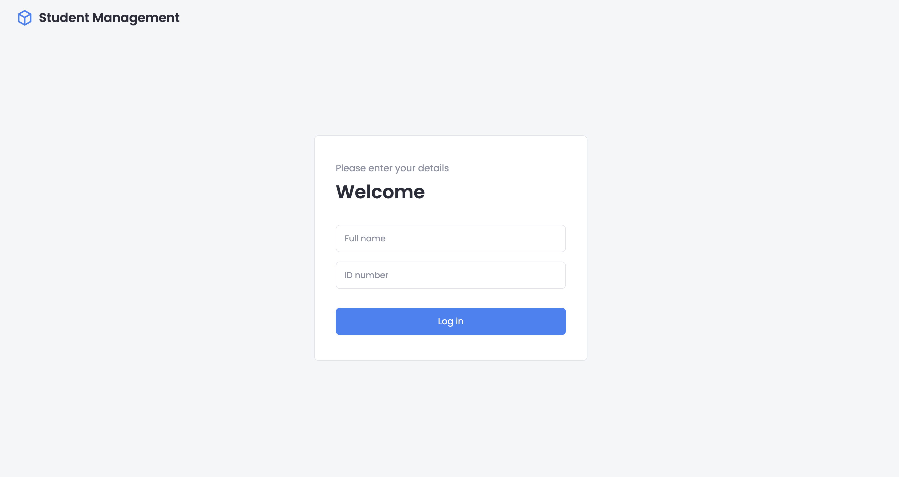
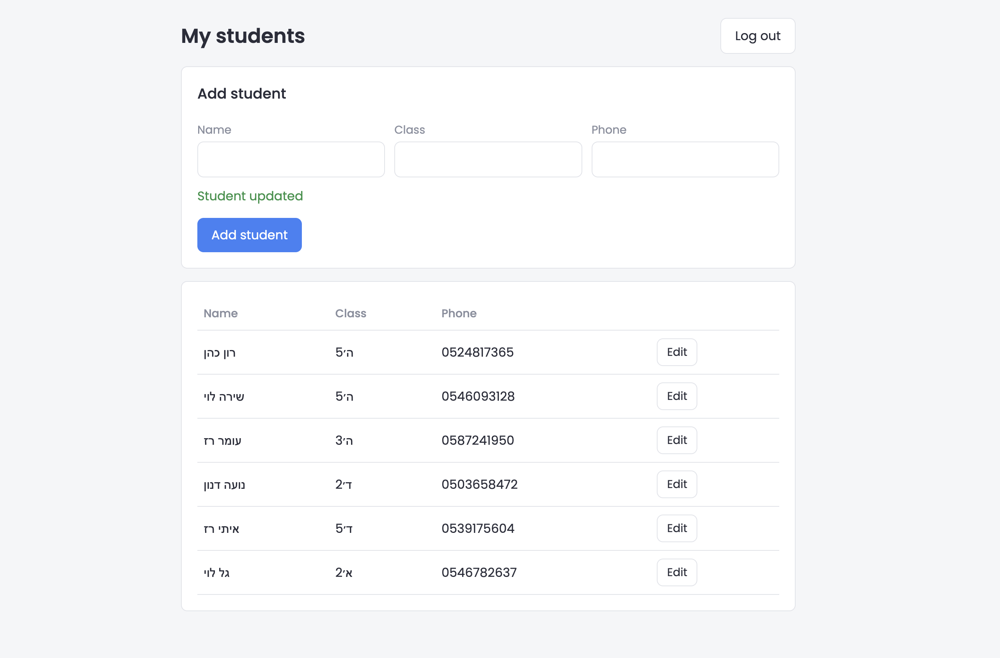

# Student Management System

A simple web app for teachers. A teacher logs in with their name and ID number, then can add students and update their details (name, class, phone).

## Screenshots




## Tech stack

- **Backend:** FastAPI, SQLAlchemy, SQLite, JWT
- **Frontend:** React + Vite, CSS

## How to run

### 1. Backend

```bash
cd backend
python3 -m venv venv
source venv/bin/activate
pip install -r requirements.txt
python seed.py
uvicorn main:app --reload
```

The server runs at http://127.0.0.1:8000 (API docs: http://127.0.0.1:8000/docs).

`python seed.py` adds a sample teacher with five students.

### 2. Frontend (in a second terminal)

```bash
cd frontend
npm install
npm run dev
```

Open http://localhost:5173

## Sample login

| Name | ID number |
|---|---|
| Dana Cohen | 318452769 |

## Project structure

```
backend/
  main.py        API routes
  models.py      Database tables (Teacher, Student)
  schemas.py     Request data validation
  auth.py        JWT token creation and checking
  database.py    Database connection
  seed.py        Sample data
frontend/src/
  App.jsx        Shows Login or Students page
  Login.jsx      Teacher login page
  Students.jsx   Add, edit and list students
  api.js         Requests to the backend
```
